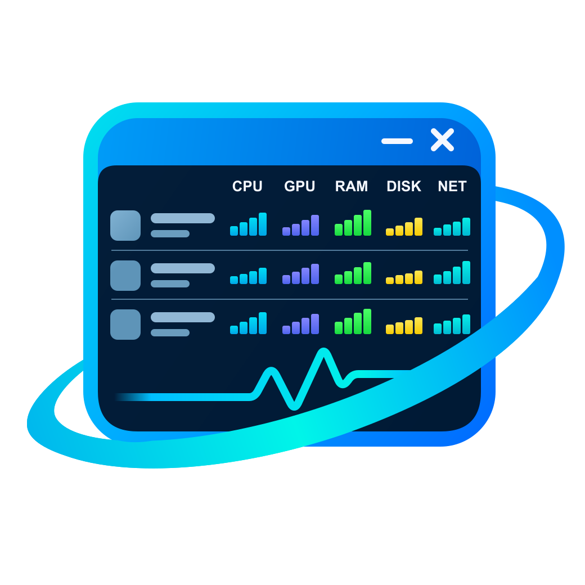
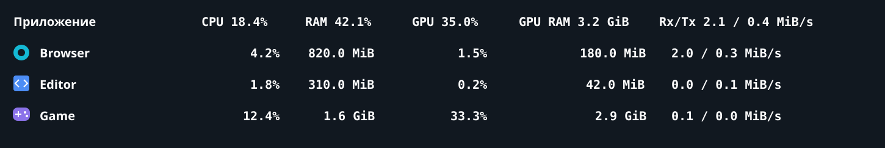

# FluxTop

<p align="center">
  
</p>

<h3 align="center">Монитор ресурсов приложений для Windows 10/11</h3>

<p align="center">
  Лёгкий нативный монитор с прозрачным оверлеем, статистикой и локальной историей.<br>
  <strong>C++20 · Win32 · Direct2D · SQLite · MIT</strong>
</p>

<p align="center">
  <a href="https://github.com/Dilichan/FluxTop/releases/latest/download/FluxTop.exe"><strong>Скачать FluxTop.exe</strong></a>
  · <a href="https://github.com/Dilichan/FluxTop/releases">Все релизы</a>
  · <a href="docs/RELEASE_NOTES.md">Что нового в v0.2.6</a>
  · <a href="https://github.com/Dilichan/FluxTop/issues">Сообщить об ошибке</a>
</p>



*Иллюстрация интерфейса с демонстрационными значениями. Фон рабочего оверлея прозрачен.*

## Возможности

| Возможность | Описание |
| --- | --- |
| **Мониторинг** | CPU, RAM, GPU, GPU RAM и Rx/Tx по приложениям; системные значения в заголовках |
| **Группировка** | Объединение процессов по исполняемому файлу, включая независимые процессы одного приложения |
| **Прозрачный оверлей** | Всегда поверх окон; выбор показателей, размера, положения, непрозрачности и количества строк (1–100) |
| **Сортировка** | «Авто» с закреплением приложения в фокусе или ручная сортировка по ресурсу |
| **Анимация** | Плавная перестановка строк с возможностью отключения; без мигания и затухания |
| **Статистика** | Живой график последней минуты, исторический AutoScore, календарь периода и аптайм приложений |
| **История** | Единая SQLite-база с минутными, часовыми и суточными агрегатами, кешем иконок и ограничениями хранения |
| **Температуры** | CPU/GPU, если Windows, драйверы или доступные датчики предоставляют достоверное значение |
| **Ядра CPU** | Загрузка и температура каждого физического ядра в статистике; столбцы нагрузки приложений на ядра в основных настройках; [подробнее](docs/CPU_UI.md) |
| **Обновления** | Проверка GitHub Releases при открытии клиента; скачивание только после согласия пользователя |
| **Автозапуск** | По выбору пользователя: задержка 30 секунд, запуск в трей, стандартный запрос UAC |

Оверлей предназначен прежде всего для оконных и borderless-игр. Он не внедряет код в другие процессы и не устанавливает драйверы.

## Установка

1. Скачайте **[FluxTop.exe](https://github.com/Dilichan/FluxTop/releases/latest/download/FluxTop.exe)** в разделе Releases → Assets. Файл `Source code` не является готовой программой.
2. Запустите EXE и подтвердите установку для текущего пользователя. Появятся ярлык в меню «Пуск» и запись в «Установленных приложениях» Windows.
3. Откройте FluxTop из меню «Пуск» и при необходимости подтвердите UAC. Настройте оверлей во вкладках клиента — изменения применяются автоматически.

Для обычного пользователя **Git, Python, PowerShell, CMake и Visual C++ Redistributable не требуются**.

Закрытие окна клиента оставляет монитор в трее; для полного выхода используйте «Завершить работу» или «Выход» в трее.

| Управление | Действие |
| --- | --- |
| `Ctrl+Alt+F9` | Открыть клиент |
| `Ctrl+Alt+F10` | Показать или скрыть оверлей |
| Двойной щелчок по значку трея | Открыть клиент |

## Обновления, удаление и данные

Скачиваемая версия проверяет новые релизы **при открытии клиента**. Отказ от обновления не скачивает EXE. При обычном запуске и автозапуске Windows фоновая установка обновлений не выполняется.

Удалить программу можно через **Параметры Windows → Установленные приложения → FluxTop → Удалить** или запустив `%LOCALAPPDATA%\FluxTop\Uninstall-FluxTop.exe`. Нативный деинсталлятор работает без `.cmd` и PowerShell. Перед удалением полностью закройте монитор через трей.

Данные остаются на компьютере после удаления: `fluxtop.db`, `fluxtop.db-wal`, `fluxtop.db-shm`, `overlay.ini`, `activity.log` и его архивы. Это позволяет переустановить программу без потери статистики и настроек. Файлы WAL/SHM нельзя удалять, пока FluxTop работает.

Сборщик не отправляет показатели приложений и историю в сеть. Сетевые обращения загрузчика используются для проверки и скачивания обновлений. Подробности — в [руководстве](docs/USER_GUIDE.md) и [политике безопасности](SECURITY.md).

## Ограничения

- **≤50 МиБ RAM — цель, а не подтверждённый результат** для активного оверлея с клиентом в трее. Открытая аналитика оценивается отдельно.
- Недоступные из-за прав или драйверов значения отображаются как `—`, а не как нулевые.
- Working Set может повторно учитывать общие страницы; GPU% группы не является суммой движков.
- Температура CPU Package, exclusive fullscreen и метрики некоторых защищённых процессов не гарантируются.
- Публичный EXE пока не имеет цифровой подписи издателя. Не отключайте защиту Windows ради установки.

## Сборка из исходников

Требуются **Windows 10/11 x64**, MSVC/Windows SDK, CMake 3.24+ и Git. В PowerShell либо Developer Command Prompt:

```powershell
cmake --preset windows -DFLUXTOP_RELEASE_TAG:STRING=v0.2.6
cmake --build --preset release
ctest --preset release --output-on-failure
```

Результаты сборки:

| Файл | Назначение |
| --- | --- |
| `build/Release/fluxtop.exe` | Монитор и консольный режим |
| `build/Release/FluxTopSource.exe` | Нативный Git-launcher для исходной копии |
| `build/Release/FluxTopSourceAutostart.exe` | Нативный запуск из исходников при входе в Windows |
| `build/package/Release/FluxTop.exe` | Самостоятельный скачиваемый установщик с монитором и деинсталлятором внутри |

Запуск из исходников после сборки: `./build/Release/FluxTopSource.exe --overlay`. Он проверяет upstream, обновляет рабочую копию **только fast-forward** при отсутствии локальных правок, выполняет CMake/CTest и сохраняет предыдущую проверенную сборку. Для отключения Git-проверки используйте `--no-update`. В отличие от него скачиваемый EXE обновляется через GitHub Releases и не требует Git.

Сборка/упаковка и тесты реализованы на **C++20, CMake и CTest**. `tools/export_brand_icons.py` оставлен только для разработки графики; две PowerShell-утилиты в `tools/` используются разработчиками для диагностики установки и измерений и не входят в пользовательскую сборку.

## Документация и участие

[Руководство пользователя](docs/USER_GUIDE.md) · [Архитектура](docs/ARCHITECTURE.md) · [Требования](docs/REQUIREMENTS.md) · [Стек](docs/STACK.md) · [История и SQLite](docs/HISTORY.md) · [Статистика](docs/STATISTICS.md) · [Запуск и обновления](docs/UPDATING.md) · [Публикация релизов](docs/PUBLISHING.md) · [План развития](docs/ROADMAP.md) · [Правила разработки](CONTRIBUTING.md)

Лицензия — **[MIT](LICENSE)**. Ошибки и предложения: [GitHub Issues](https://github.com/Dilichan/FluxTop/issues).
